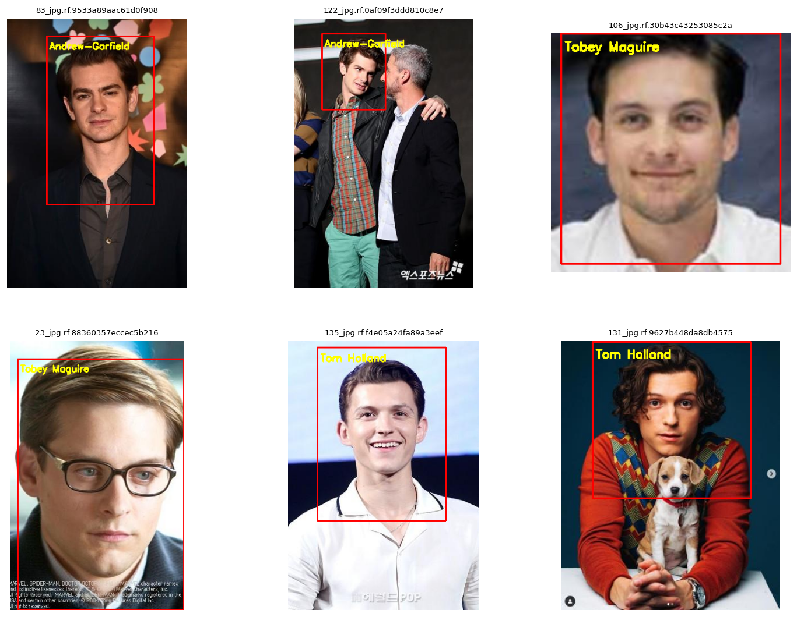
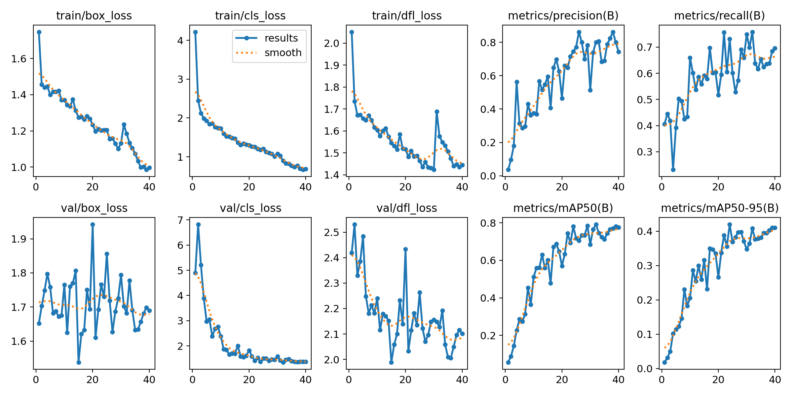
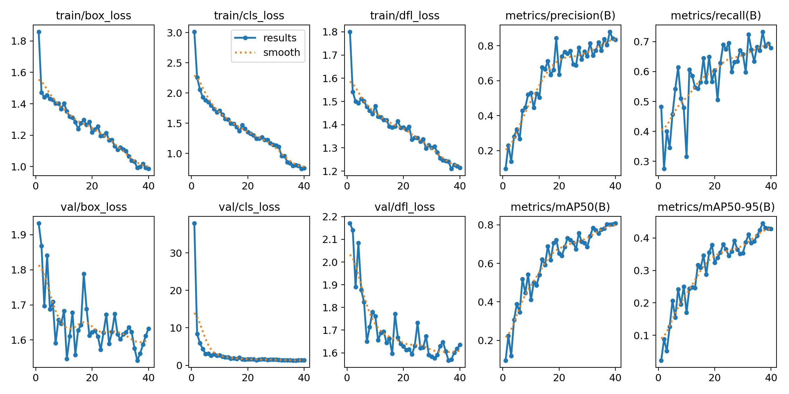
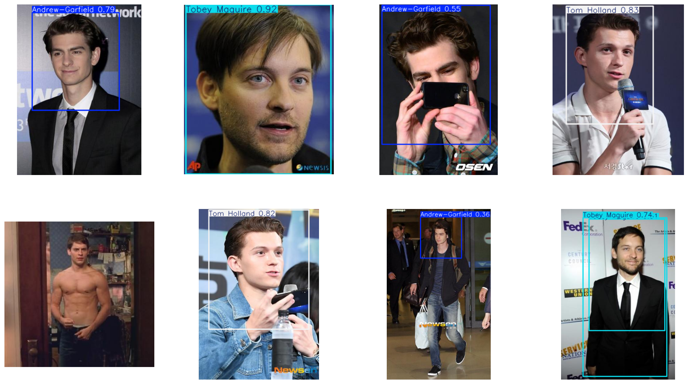
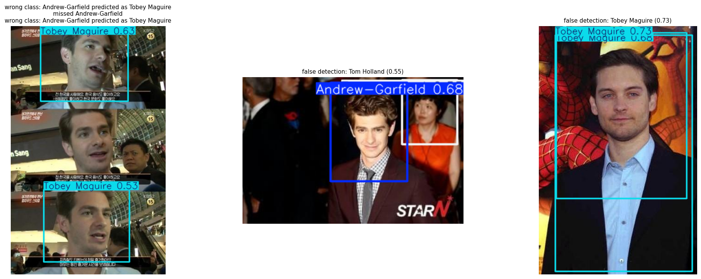

# 🕷️ Who's Under the Mask? A Spider-Man Actor Detector

Can a tiny neural network tell **Andrew Garfield**, **Tobey Maguire** and **Tom Holland** apart? This project fine-tunes a small YOLO11 object detector to draw a box around an actor's face and say which Spider-Man actor it is.

- **Course:** CSCI1409 Deep Learning, KBTU, Fall 2026, bonus project (individual work)
- **Author:** Ayaulym Aitore
- **Run it in your browser:** 
- **Final trained checkpoint (5.5 MB):** [weights/final_best.pt](https://github.com/Ayamourr/spiderman-actor-detector/raw/main/weights/final_best.pt)

**Short version of the results:** the final model (YOLO11n, image size 320) gets **mAP@0.50 = 0.834** on the held-out test set (precision 0.717, recall 0.778). It is far from perfect. Its favourite mistake is drawing boxes around faces that are not any of the three actors. See [Failure analysis](#5-failure-analysis).

---

## 1. The task

**Object detection:** given a photo, find faces and say which of the 3 classes each one is.

| ID | Class name |
|---|---|
| 0 | Andrew-Garfield |
| 1 | Tobey Maguire |
| 2 | Tom Holland |

---

## 2. Dataset

| | |
|---|---|
| **Source** | Roboflow Universe, "actor Computer Vision Dataset" by **soo236**: https://universe.roboflow.com/soo236/actor-11ga2 |
| **License / usage terms** | CC BY 4.0 (credit the author). The photos show real people and were collected from the internet by the dataset author; I did not check the rights of each photo, so I use them only for this course project and do **not** upload the images to GitHub. |
| **Annotation format** | YOLO text files: one `.txt` per image, one line per box: `class x_center y_center width height`, all numbers between 0 and 1 (fractions of the image size). The boxes were drawn by the dataset author. |
| **Export** | Roboflow export "YOLO11", version 1. Preprocessing: Auto-Orient only. **No resizing and no augmentation** in the export. |
| **Where to get it** | Mirror used by the notebook (Google Drive, "anyone with the link"): [actor.zip](https://drive.google.com/file/d/1S7XdQ38M0z938mVoYKqjtCBmw8R5ej74/view?usp=sharing). The original is on Roboflow Universe (link above). |
| **Total** | 397 images, 428 boxes |

### Images and boxes per split (after my duplicate fix, see below)

| Split | Images | Boxes | Andrew-Garfield | Tobey Maguire | Tom Holland |
|---|---|---|---|---|---|
| train | 282 | 304 | 104 | 84 | 116 |
| valid | 77 | 82 | 26 | 29 | 27 |
| test | 38 | 42 | 19 | 9 | 14 |

### Label check
- Script check on all 397 images: **0 images without a label file, 0 empty label files, 0 broken lines** (wrong class number or values outside 0–1).
- I also looked through many images in Roboflow and plotted samples myself. The class names looked right. **The box style is not consistent**: some boxes cover only the face, some head and shoulders, some the whole standing person. I did not fix this (see Limitations).

### Ground-truth examples (2 per actor, drawn from the training set)

### Splits, duplicates and seeds
- The train/valid/test split (originally 278 / 79 / 40) was made by the dataset author on Roboflow. I do not know their seed, so I **did not create a new random split**.
- Near-duplicates and photos of the same event must stay in one split. I checked with **perceptual hashing** (pHash, a short fingerprint of an image):
  1. Whole images: hash distance ≤ 8 → 1 leaking pair found (a mirror selfie, copies in train and valid). Log: [`evidence/split_fixes.txt`](evidence/split_fixes.txt)
  2. Cropped boxes: distance ≤ 10, to catch the same event from another angle → 4 more images moved. Log: [`evidence/crop_split_fixes.txt`](evidence/crop_split_fixes.txt)
  3. Rule: a leaking image is moved into the *earlier* split (train → valid → test).
- Result: 5 images moved, final sizes **282 / 77 / 38**. The method has **no randomness**, so there is no seed. Training seed = 0, example-picture seed = 42.
- Limit of the method: pHash can miss heavily cropped or edited copies of the same photo.

---

## 3. Setup and how to run

**Easiest way (Google Colab, free):**
1. Click the **Open in Colab** button at the top.
2. **Runtime → Change runtime type → T4 GPU → Save.**
3. **Runtime → Run all.** It takes about 10 minutes. The notebook installs the exact versions, downloads the data, cleans it, trains both models, evaluates, and shows predictions.

**What is in this repo**

| File / folder | What it is |
|---|---|
| `spiderman_detector.ipynb` | The whole project as one notebook |
| `requirements.txt` | Exact package versions |
| `weights/final_best.pt` | Final trained checkpoint (YOLO11n, image size 320) |
| `evidence/` | Learning curves, logs, configs, prediction pictures, split-fix logs for both runs |
| `Untitled1` | My first notebook project without any explanations |

**If the Drive download fails** ("too many users" error): wait a few minutes and re-run that cell, or download the YOLO11 export from the Roboflow link above and upload it to `/content/data/actor`.

**Versions used:** Ultralytics 8.4.216, PyTorch 2.14.1 (CUDA 13.0), Python 3.13.16, Google Colab Tesla T4 GPU.

---

## 4. Training and the experiment

### Settings (same for both runs unless noted)

| Setting | Value |
|---|---|
| Framework | Ultralytics 8.4.216 |
| Model | YOLO11n (nano, 2.59 M parameters) |
| Initial weights | `yolo11n.pt` (pretrained on COCO) |
| Image size | **640 (baseline) / 320 (experiment)** |
| Batch size | 16 |
| Epochs | 40 |
| Optimizer / learning rate | AdamW / 0.001 |
| Seed | 0 (deterministic mode on) |
| Augmentation | Ultralytics defaults (mosaic, flip, colour changes, scaling) in both runs |
| Best checkpoint | `best.pt`, chosen by Ultralytics from **validation** results |

Saved for each run in `evidence/<run>/`: `args.yaml` (full config), `results.csv` (log of every epoch), `results.png` (learning curves), `confusion_matrix.png`, `summary.json`, `best.pt`.

| Baseline (640) | Experiment (320) |
|---|---|
|  |  |

### Hypothesis (written before running the second model)
> Our photos are small (median 340 × 415 pixels). Shrinking the training image size from 640 to 320 should lose only a little accuracy and make training faster.

### Result (validation set: 77 images, 82 boxes; confidence 0.001, IoU 0.7)

| Run | Changed setting | Precision | Recall | mAP@0.50 | Training time |
|---|---|---|---|---|---|
| baseline | image size 640 | 0.743 | 0.736 | 0.769 | 3.9 min |
| experiment | image size **320** | 0.836 | 0.731 | 0.805 | 2.2 min |

Training time is the wall-clock time of the whole run (including the one-time download of the starting weights in the first run), on a Colab T4.

### Explanation
- **The hypothesis was right about speed and a bit too careful about accuracy.** 320 was faster and *not worse*; its mAP was even 0.036 higher.
- **Likely reason:** the photos are already small (median 340 × 415). At size 640 YOLO has to blow them up almost 2×, which adds no new detail and only costs compute. At 320 the image is close to its real size.
- **Careful:** the gap is small and comes from 77 validation images, 82 boxes and one seed. It could be luck. I can claim "320 is at least as good as 640 here", not "320 is better". Repeating with several seeds would tell more.
- Validation images also chose the best epoch, so validation scores are a little optimistic. That is why the final number comes from the test set.
- **Final model:** `imgsz320`, chosen using validation results only.

---

## 5. Final test results

The checkpoint `weights/final_best.pt` was evaluated **once** on the test set (38 images, 42 boxes). The test set was not used to choose any setting.

**Evaluation settings:** confidence threshold 0.001, NMS IoU 0.7, image size 320, mAP counts a box as correct when it overlaps the true box with IoU ≥ 0.50.

| Class | Images | Boxes | Precision | Recall | mAP@0.50 |
|---|---|---|---|---|---|
| **all** | 38 | 42 | **0.717** | **0.778** | **0.834** |
| Andrew-Garfield | 17 | 19 | 0.799 | 0.632 | 0.762 |
| Tobey Maguire | 9 | 9 | 0.541 | 0.778 | 0.793 |
| Tom Holland | 14 | 14 | 0.812 | 0.924 | 0.946 |

(mAP@0.50–0.95 = 0.426.) The model's precision and recall are the values Ultralytics reports at the confidence level with the best balance between them (best F1).

### What the metrics mean
- **IoU** (intersection over union): how much a predicted box overlaps the true box. 1 = perfect, 0 = no overlap.
- **Precision:** of all boxes the model drew, how many were correct. Low precision = lots of false alarms.
- **Recall:** of all real actors in the photos, how many did the model find. Low recall = lots of missed faces.
- **mAP@0.50:** for each class, we draw a curve of precision against recall while moving the confidence threshold. The area under it is the average precision (AP). The mean over classes is mAP. "@0.50" means a box counts as correct when IoU ≥ 0.5.

### Test predictions (8 random test images, confidence ≥ 0.25)

### Failure analysis
With confidence 0.25, **16 of the 38 test images** had at least one error by my strict counter (the script is in the notebook, Step 9). Most were **extra boxes** (14 images), then missed or badly placed boxes (5) and wrong actor (3). Many of the extra boxes have low confidence (0.27–0.45). Note that a box with the wrong size counts as both "missed" and "extra", so some of these errors are really box-style problems and not wrong faces.

| # | Test image | What went wrong | Likely cause |
|---|---|---|---|
| 1 | `105_jpg…` (left) | **Wrong class:** Andrew Garfield was called Tobey Maguire (confidence 0.63 and 0.53). | The picture is three blurry TV-interview frames with subtitles, and the faces are turned with the mouth open. Andrew has only 104 training boxes, so the model is unsure and falls back on a similar-looking class. |
| 2 | `116_jpg…` (middle) | **False detection:** a Tom Holland box (0.55) on a woman in the background. | The model was trained on faces that are always one of 3 actors, so it never learned to say "nobody I know". Any face gets pushed into one of the three classes. |
| 3 | `117_jpg…` (right) | **Duplicate box:** two Tobey Maguire boxes (0.73 and 0.68) on the same man, one of them much taller. | The training labels mix face-only, head-and-shoulders and whole-body boxes, so the model learned several "correct" box sizes. The overlap of the two boxes is below the 0.7 NMS limit, so both survive. |

**One practical next step:** add a few dozen photos of *other people* (no boxes, or a 4th class `other`) so the model learns that not every face is a Spider-Man. This would target the most common error (extra boxes) and would also allow an "unknown actor" answer. A second step, if time allowed, would be to make all boxes face-only.

---

## 6. Limitations

- **Small data:** 397 photos in total; the test set has only 38 images and just 9 Tobey Maguire boxes, so every test number is noisy. The test score being higher than the validation score does not mean the model is better; it is probably luck.
- **One seed, one split:** no confidence intervals. The 640 vs 320 difference may be chance.
- **No "unknown" class:** the model can only answer with one of the 3 actors. Faces of other people are often labelled as an actor.
- **Mixed box styles** (face / upper body / whole body) make boxes and scores less reliable.
- **I trust the dataset author's class labels.** I could not check every identity myself.
- **Shortcut risk:** the model may partly use costumes, scenes or photo style instead of faces (the three actors appear in different films). I did not test this.
- **Near-duplicate check is imperfect:** pHash can miss edited or heavily cropped copies. 5 images were moved, which makes the test set smaller than the author's original.
- **Internet photos:** I did not check the copyright of each image; they are not redistributed here.

---

## 7. Credits and AI help

- Dataset: "actor" by **soo236** on Roboflow Universe, CC BY 4.0.
- Detector: **Ultralytics YOLO11** (https://github.com/ultralytics/ultralytics, AGPL-3.0), used as a library with pretrained `yolo11n.pt`. I did not write the model; **my own parts** are: choosing and checking the dataset, the duplicate/leakage cleaning, the training and experiment code in the notebook, the evaluation, failure analysis, and this write-up.
- **AI help:** I used **Claude (Anthropic's AI assistant)** to explain concepts step by step, to help write and debug notebook code, and to draft this README. I ran all the code myself on Google Colab and the numbers above are copied from my own runs. I adapted the crop-based duplicate check myself.
